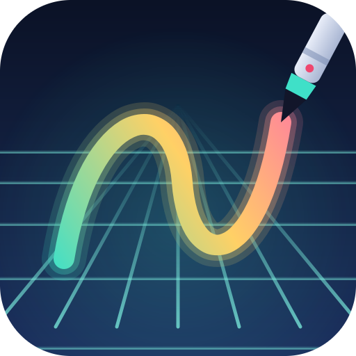
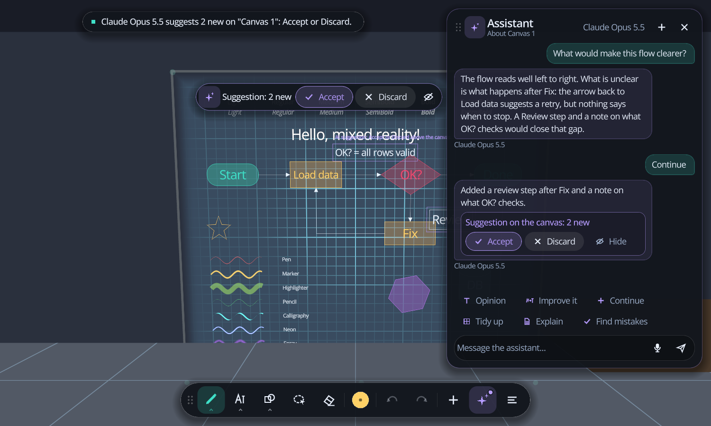
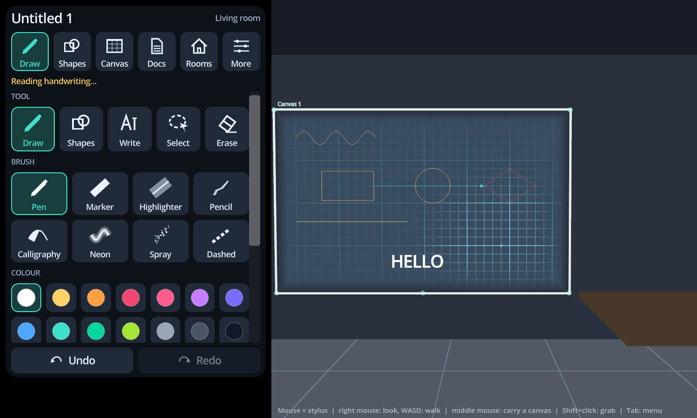

# MR Whiteboard

An infinite whiteboard for the **Meta Quest 3** and the **Logitech MX Ink** stylus, built with **Godot 4.7.2**. It runs only in mixed reality (passthrough), is operated with bare hands, and uses the stylus whenever you draw. The same project also runs as a **PC app** so you can try everything without a headset.



<p>


</p>

*The PC test app (screenshots): talking with the assistant about the demo canvas, and strokes snapped to clean shapes with handwriting read as text, its other readings one tap away.*

## What it does

| | |
|---|---|
| **Guide** | A **user guide inside the headset**: the **?** in Home's header (or Home > Settings > How to use it) opens it beside the dock, and the very first start opens it by itself. Sixteen topics (the basics, draw, shapes, handwriting, typing and dictation, select, erase and undo, canvases, the desk, the curved desk, the assistant, documents and sharing, a PDF, 3D models, a session, comfort; the PC's keys as a seventeenth on the PC), each a few plain steps, a table of the stylus's buttons / the hand gestures / the colours of the pointing ring where that helps, and **Try it** buttons that do the thing for real (pick the tool, open its options, start placing a canvas, open the typing card) and make a ring breathe around the real dock button, so you see where it is. It stays open while you try. See [The guide](#the-guide). |
| **Interface** | Out of the way of the work: a slim **dock** of tools low in front of you, and small panels that appear only where they are needed: a tool's options above it, a **bar above the selection** with what fits it (text styles, recolour, to text, label, fill, order), Home and the assistant beside the dock. Everything fades back while you draw. See [The interface](#the-interface). |
| **Canvases** | Place a canvas on a wall, on a table or in mid-air whenever you want. The grid fades in around the stylus, fades out as you walk away and fades at the edges. Draw past the edge and the canvas grows: it is infinite. **Hide** a canvas with the eye button (Home > Canvases): it disappears for everyone in the session until you show it again. **Lock its place** (Home > Canvases, the arrows-and-padlock button) and it stays exactly where it is, facing the same way: two hands then only resize it, about its middle (on a curved desk they zoom what is drawn). |
| **Desk canvas** | **Add > On my desk**: press the stylus tip on your desk in a few places (or rub it across): the tip's pressure sensor finds the surface and a canvas lies on it. It can be moved around the desk, turned and scaled, and never leaves the surface; touching the desk while you draw keeps it exact. Works on any flat surface, a wall too. See [The desk](#the-desk). |
| **Curved desk** | **Add > Curved desk**: a desk canvas that faces you, lies flat on the desk in front of you, **bends up at a distance you set and climbs the wall**. Draw anywhere on it; push the contents away from you and they slide along the desk, round the bend and up the wall (lengths are kept: nothing is stretched). Touch your desk's front edge and the wall behind it, and it lines up with your real desk. Two round markers on its left edge set the **distance** and the **radius** of the bend: drag them with the stylus or a pinch. Also: the curve button of any canvas on a level desk. See [The curved desk](#the-curved-desk). |
| **Rooms and anchors** | Every canvas and sketch is fixed in the real room by a Meta **spatial anchor**, and so are the panels you moved: after a restart, with the headset taken off and put back on, after a recentre, or going back to a document, everything is where you left it, at the size you left it. The app recognises the room you are in by its anchors (the room's own, or any of its canvases'), shows only that room's content, and offers to create a room when you walk into a new one. When the headset finds several rooms at once (a Quest 3 maps the whole home, so the room next door is found too), you are in the one you stand nearest to. Moving something and letting go fixes it at its new place with a new anchor. |
| **Documents** | Several documents, listed and opened like Word documents, with auto-save. Duplicate, rename, delete. |
| **PDFs** | Drop a PDF on the web page (or pick one in **Add > PDF**) and it stands in front of you as a canvas, **page by page**: a bar under it turns the pages (arrows, a slider over all of them, Page Up / Page Down on a keyboard). Text, lines and shapes of the page are drawn as vectors by the app itself, so they stay sharp however near you come; pictures keep their pixels. You can draw on every page, and a drawing belongs to the page it was drawn on. In a session each guest is given the file by the owner, once; the owner's page turns are everybody's, and a guest looks at other pages for themselves. A Quest 2 draws a lighter page than a Quest 3. See [PDF documents](#pdf-documents). |
| **3D models** | Drop a **glTF** (`.glb` / `.gltf`) or **OBJ** model (with its `.mtl` and pictures, or all in a `.zip`) on the web page: it stands in front of you, **lit like a product photograph** (key, fill and rim lights, soft light and reflections from a studio sky, a soft shadow on the table or floor under it). Tap it for **handles**: arrows, squares and a ball to **move**, rings to **rotate**, corner and axis cubes to **scale** and stretch, with snapping; or **grab it with your fist** as you would a real thing (or pinch it) to carry and turn it, and turn and resize it with **two hands**. In a session every headset gets it; a Quest 2 takes smaller models. See [3D models](#3d-models). |
| **Brushes** | Pen, marker, highlighter, pencil, calligraphy, neon, spray, dashed. 14 colours plus a full colour picker, width 1-40 mm, pressure sensitive. |
| **Shape recognition** | Hold the stylus still at the end of a stroke and a **straight line, arrow, rectangle, square, circle, ellipse, triangle, diamond, pentagon, hexagon, parallelogram or polygon** snaps to a clean vector shape (or choose "Always"). |
| **Vector shapes** | Snapped shapes are real shapes: select them, drag, resize with handles, rotate, change colour / fill / width. Three round buttons beside the selection box undo, redo (200 levels) and delete (a delete is taken back with undo). |
| **Flow diagrams** | Stencils (process, decision, start/end, data, document, database ...), arrows and elbow connectors that **stick to the shapes and follow them** when you move them. |
| **Handwriting to text** | Write words with the stylus (Write tool) and pause: they become typed text in the **current text style** (Body, Heading 1, ...), right where you wrote. Written inside a box, the text becomes the box's label. **Predicted:** lines, underlines, boxes and arrows drawn among the words stay drawings; words written with the ordinary **Pen** are noticed and offered as text with one tap; right after a conversion the other readings sit beside the text. |
| **Speech to text** | The **Dictate** button (microphone, right of the Pen) opens its own card, which stays open until you tap the button again or pick something else. Tap **Dictate** in it, speak, pause: the words wait as a ghost that follows the stylus or hand over the canvases (the **placement tool**); tap with the stylus tip or pinch to put them down there (one undo step, selected so you can move them), **Where I look** puts them on the canvas in front of you, **Cancel** or the back button throws them away. Text style is chosen in the same card. No AI model is involved. The chat's own microphone is separate: what you say there is a question, and the answer stays in the chat. The correction box has a Dictate button too. |
| **Typing** | Tap **Type** (or press any key on a Bluetooth keyboard, **T** on the PC): type text onto the canvas you are looking at. With text selected it edits it, with a box selected it becomes the box's label. Works with a **Bluetooth keyboard** and an **on-screen keyboard** at the same time. |
| **AI assistant** | A **chat** with **Claude, OpenAI or MiniMax** (your own API key) about the canvas in front of you: type or speak, or tap **Opinion**, **Improve it**, **Continue**, **Tidy up**, **Explain**, **Find mistakes**. Each canvas has its own conversation. Drawings arrive as a **suggestion layer over the canvas**, with a card in the conversation and a bar on the canvas to **Accept** (one undo step) or **Discard**. Models and thinking levels come from the provider. |
| **Sessions** | One owner and any number of guests on the same Wi-Fi see and edit **the same canvases**, each in their own headset: the owner starts a session, guests pick it from a list (or type its address) and give a four-digit code. Edits go both ways at once, the owner decides who may draw and whether guests may move canvases, and everybody sees where the others point. Touch two real places and the headsets line up on the same real room. Quest 2 and Quest 3 can be in one session; only one person needs the stylus. See [Running a session](#teaching-a-session). |
| **Export** | **SVG** (one file per canvas, for Inkscape / Illustrator / Figma), **glTF .glb** (the canvas ink as 3D) and the document file **.mrw**. **Home > Share** also lets a browser on your PC view, download, delete and add canvases (see below). |
| **Telegram** | Your own Telegram bot links the headset to your phone over the internet, on any network: send it a PDF, an SVG, a 3D model or a .mrw document and it appears in front of you; send text and put it on a canvas; `/svg`, `/glb`, `/mrw` (or **Home > Docs > Send to Telegram**) send the open document back. See [Telegram](#telegram). |
| **PC test app** | Mouse as the stylus, a fly camera as your head, a simulated room and simulated anchors (switch rooms in Home > Rooms). |

## Run it

### On the PC (no headset)

```
godot --path . res://scenes/main.tscn           # or: pwsh tools/pc.ps1
pwsh tools/pc.ps1 -Demo                          # opens a demo document
pwsh tools/pc.ps1 -Export                        # builds build/pc/MRWhiteboard.exe
```

Controls (the interface floats over the view; **Tab** hides it, **Esc** closes the topmost panel): **left mouse** draws on the canvas under the pointer (on a 3D model: selects it; on its handles: moves, turns, resizes it), **Shift+left** is the stylus front button (grab: an item, the bar under a canvas, a corner, or empty canvas to carry it), **middle mouse** pinches (carry a canvas, wheel scales it, Q/E turn it), **right mouse** looks around, **WASD** walks, **Ctrl+Z / Ctrl+Y** undo / redo, **C** places a canvas, **F** finds the desk (the mouse lands on the simulated table), **1-5** switch tools, **B** the brush, **T** type, **Delete**, **Ctrl+D**, **Ctrl+S**. A graphics tablet gives pressure. Drag the dock, Home or the assistant by their dotted grip.

### On the Quest 3

One-time setup:

1. Quest: turn on **Developer Mode**, connect USB and accept the debugging prompt.
2. Quest: run **Space Setup** (Settings > Environment) so the room is scanned: anchors, walls and tables depend on it.
3. Quest: pair the **MX Ink** and choose its hand in **Settings > Devices > Stylus**.
4. PC: install the Godot 4.7.2 export templates, then once `pwsh tools/setup_android.ps1`.

Build and install: `pwsh tools/quest.ps1` (add `-NoInstall` to only build `build/MRWhiteboard-Quest3.apk`, `-Logs` to stream the app log).

Quit with **Quit** at the top of Home (press it twice; the document is saved first).

Using it: the dock appears low in front of you. **Touch** a button with the stylus tip or a fingertip, or **point and pinch** (stylus: **front button**) from a distance. Grab the bar under the dock (or under Home, the assistant) to move it, by touching it or pointing at it; **open your palm facing up** (or hold the stylus front button with nothing to grab) to bring the dock to you. The bars on a canvas (above a selection, beside handwriting) are touched with the nib like the canvas.

One vocabulary for both tools: **point** (a ring shows where; the stylus also has a beam out of its nib, like the Quest's own ray), **act** (draw / press), **grab** (pinch, or the stylus front button), **undo**, **menu**. A pointer **touches** a canvas when it is within 12 cm of it, and then grabs 1:1; further away it **points**, and what it grabs moves further than the hand (by the ratio of their distances from your head).

| Stylus | |
|---|---|
| Tip pressed on a canvas / middle button | the current tool: draw (pressure sensitive), write, erase, select, shape |
| Hold still at the end of a stroke | snap to a line / shape |
| Front button | grab, like a pinch: an item is selected and dragged, the bar under a canvas or empty canvas carries it, a corner changes its size. By touch, or by pointing along the stylus |
| Back button | undo, at once. With the front button held: redo |

| Hands | |
|---|---|
| Point | the runtime's hand ray (OpenXR hand interaction profile): a ring shows where it lands |
| Pinch a shape, line or stroke | select it and drag it (its handles reshape it). Hands always arrange, whatever tool the stylus has |
| Pinch empty canvas | let go of the selection (a drag carries the canvas). Pointing from afar with the Select tool chosen, a drag draws a lasso instead (the stylus front button too) |
| Pinch the bar under a canvas | carry the canvas; letting go fixes it with a new anchor |
| Pinch a canvas corner | change its extent |
| Second hand on the same canvas | turn and resize (a curved desk: turn, and zoom what is drawn on it) |
| Palm up | bring the dock in front of you (also: hold the stylus front button with nothing to grab). The dock and the side panels otherwise stay where you left them in the room; at start they come in front only if their place is more than 2.5 m away or not found within 5 s |

Undo and redo are always on the dock. A pinch ticks (a soft click) and the stylus pulses: **Home > Settings > Feedback** switches both off.

Every input, threshold and tunable number is documented in [docs/INTERACTIONS.md](docs/INTERACTIONS.md).

Drawing is the stylus's job and happens only on canvases (drawing in the air is switched off). **Home > Settings > Draw with a pinch** lets the right hand draw by pinching on a canvas when there is no stylus; away from a canvas's surface (pointing, its bar, a corner, a panel's handle) it grabs like the left hand.

## The interface

The work is the canvas, so the interface stays small and comes to where it is needed ([UiShell](src/ui/ui_shell.gd)):

| | |
|---|---|
| **Dock** | Pen, Write, Shapes, Select, Erase · the brush (its colour and width) · undo, redo · **Dictate** right of the Pen · **Add** (type text, a new canvas) · the **assistant** · **Home**. Icons only; each names itself when hovered. Tap the active tool again for its options. |
| **Popovers** | above the dock button they belong to: **Brush** (brush, colour, any colour, width with a live sample, snapping), **Shapes** (stencils, fill, sticky connectors), **Handwriting** (text style, convert after a pause, language, what the pen does with writing), **Add**. Drawing on a canvas closes them. |
| **Selection bar** | above what is selected, on the canvas: recolour · text: H1 / H2 / H3 / Body / Small, bold, italic, weight, edit, and the other readings of converted handwriting · ink: to text · a box: label, fill · duplicate, front, back. Undo, redo and delete stay the round buttons beside the selection box. |
| **Ink chip** | beside handwriting: *Convert to text* when the pen notices words, the other readings right after a conversion. |
| **Desk card** | while the stylus feels for the desk: a plan of the points, what is still needed, how level and flat the desk is, Done / Start over / Cancel (stands on the dock; on the PC at the right). |
| **Suggestion bar** | inside the top of a canvas the assistant drew on: Accept, Discard, Hide. |
| **Home** | Documents (new, duplicate, save, export, all documents), Canvases, Rooms, Share (the web page), Session, Settings, Quit, and the **?** that opens the guide. |
| **Assistant** | the conversation about the canvas in front of you (see [AI assistant](#ai-assistant)). |
| **Typing card** | every bit of typing: new text, edits, labels, names, keys, chat messages in the headset; with the on-screen keyboard. |

While the pen draws, erases or drags, or a hand carries something, the panels fade back and the bars on the canvas step away; they come back
a moment after. In the headset each panel floats on its own: the dock low in front of you like a keyboard, popovers standing on it, Home and
the assistant beside it, the bars pinned 12 mm in front of the canvas. Only a panel's own surface catches the pointer.

**Writing, predicted** ([WritingDetector](src/ink/writing_detector.gd)): from the shape of the ink alone (letters of a similar height, side
by side in reading order, curvy; a line much longer than the letters, a loop round them, something far taller) the app tells writing from
drawing. In Write mode, an underline, a strike, a box round the words or an arrow (shaft and head) is kept as a drawing instead of being
read. With the Pen, words are watched; once the pen rests, a chip offers to turn them into text (Handwriting popover: *Offer to convert*,
*Convert* by itself, or *Off*); *Keep as drawing* is remembered. No ink is sent anywhere until you convert.

## The guide

How to use each feature, in the headset, so nobody needs this page. It is a seventh page of Home ([GuidePage](src/ui/guide_page.gd)) without a tab of its own: the **?** in Home's header opens and closes it, and Home > Settings > How to use it has a button for it. The first start of the app opens it once (`guide_seen`), with a ring round the Home button so you know where to find it again.

A topic is plain data at the top of `guide_page.gd`: a title, a one-line summary, and blocks (a paragraph, numbered steps, a two-column table, **Try it** buttons). The Try it buttons come first, because the guide stays open beside the dock while you try: a tool or a popover is opened for real (`tool:`, `pop:`), a canvas ghost is put in your hand (`place:`), the typing card or the desk search starts (`type:`, `desk:`), a Home tab or the assistant opens (`tab:`, `side:`), and `pulse:` / `all:` make a ring breathe around the real dock button (`Btn.pulse`, `Dock.pulse`) for a few seconds. To document a new feature, add a topic (or a step); `tests/test_ui_smoke.gd` opens every topic and checks that every button uses an action the guide knows. The PC's keys are a topic of their own, left out in the headset. Try it with `godot --path . res://scenes/main.tscn -- --demo --tab=guide [--topic=draw]`, or `--welcome` for the first-start look.

## The desk

A canvas that lies on a real surface. **Add (+) > On my desk** (or **Home > Canvases** and the desk button of a canvas you already have; the same button frees it again): the card that appears asks you to press the **tip of the stylus** on the desk. The tip force sensor knows when the nib touches something, so each press is a point of the surface; a quick tap is one point, a rub across the desk is many. The points appear in the room, a plan on the card shows how far they spread, and a plane is fitted through them (any tilt: a wall works as well). **Done** is ready when the points are spread out and flat enough (the card says what is missing and how level the desk is); the canvas then lies exactly on the surface, facing you.

The canvas is bound to the surface. Carry it (pinch, the stylus front button, two hands), turn it, scale it: it slides, turns and grows on the desk but never leaves its plane, whatever your hand does in the air. A corner still changes its extent; **Home > Canvases > desk button** frees it again, and *Bring the canvas to me* leaves it alone. While you draw on it, every touch of the nib is another measurement: if the headset's idea of the desk drifts (or the first few taps were a degree out) the canvas follows the real surface. A thin amber edge and "on the desk" in its title mark it. How it works, with every number: [docs/INTERACTIONS.md](docs/INTERACTIONS.md) section 10.1.

## The curved desk

A canvas for working at a desk with a wall behind it. **Add (+) > Curved desk** (or **Home > Canvases > New curved desk**, or the curve button of a canvas that already lies on a level desk): feel for the desk with the stylus tip as in [The desk](#the-desk). Then **line it up with your real desk**: the card asks you to touch the desk's **front edge** in front of you, then the **wall** behind the desk (or the desk's far edge). The canvas starts at that edge, runs away from you along the desk and **bends up** through a quarter circle (12 cm) so that its upright part **climbs the wall** exactly where your wall is. **Home > Canvases > Line it up with my desk** does it again whenever you like.

What you draw is an ordinary canvas page (same coordinates, same sizes, exports and sessions as ever); the surface only decides where a part of the page appears in the room, like a sheet of paper laid on the desk and curved up. A line keeps its length round the bend. **Push the contents away from you** with a pinch on the canvas (or the stylus front button) and they slide along the desk, round the bend and up the wall; pull them back and they return. Pointing from further away, what you pinched stays under your ray. What slides off the end is hidden, not lost (and cannot be picked until it is back). **The bar** in front of the desk carries the desk itself along your real desk, and **two hands** (or a hand and the stylus) turn it; moving them apart or together **zooms what is drawn** (0.25x to 4x) about the spot between them, while the desk, its bend and its markers keep their size.

**Two round markers** stand on the left edge: the one where the flat part ends sets the **distance** (slide it along the desk), the one at the foot of the wall sets the **radius** (slide it up and away). Touch one with the nib or pinch it; it lights up and says its number. Home > Canvases shows both numbers too, with minus and plus. Everything is one undo step, every headset of a session sees the same bend, and the pen, the hands, the mouse and the pointing rays all work on the bent surface. Details and every number: [docs/INTERACTIONS.md](docs/INTERACTIONS.md) section 10.3. Try it without a headset: `godot --path . res://tools/dev/ui_showcase.tscn -- --demo --show=curved --out=PATH` (on the PC the curved desk is Add > Curved desk, then the mouse presses on the simulated table).

## Handwriting recognition

Handwriting is read by Google's handwriting input service (the one behind Google Input Tools), which understands real pen strokes with timing: print, cursive, digits, symbols, many languages. It needs an internet connection; only the pen strokes are sent. **Bad handwriting:** the service returns several candidate readings; select the converted text and tap another reading, choose **Retype / rewrite** (type on the PC, write a name in the pad in the headset), or **Back to handwriting**, which restores your original strokes (they are kept inside the text, also after saving). Converting happens after a pause you can lengthen, or only when you press **To text**; ink that cannot be read is simply left as ink. Writing a little larger and slower than usual gives the recogniser the most to work with. It is an unofficial endpoint, so if it changes, the app says so and leaves your ink untouched. `InkRecognizer` is a small interface (`src/ink/`) for plugging in another recogniser, for example an on-device model.

## Typing

**Type** (in Add on the dock, or **T** / any key on a keyboard) opens the typing card above the dock: new text goes on the canvas you are looking at, below earlier text and selected so you can move it. With a text item selected the box edits it (one undo step); with a box or other closed shape selected, what you type becomes its **label**. Names of documents, canvases and rooms use the same box on one line. Enter accepts a one-line name; in the text box Enter is a new line and **Ctrl+Enter** or **OK** accepts. **Dictate** works inside the box too, and the keyboard button swaps the on-screen keyboard for the handwriting pad.

* **On-screen keyboard** (`VKeyboard`, vector-drawn): letters, digits, symbols, shift (double tap: caps lock), caret arrows, backspace that repeats. It is part of the typing card, so it is always next to the field being typed (text, names, the Wit.ai token, API keys) and sends real key events, exactly like a physical keyboard. Keys fire on press, so poke or point-and-pinch like on a real keyboard.
* **Bluetooth keyboard**: pair it in the Quest settings; its keys arrive in the app window and are passed on to the typing card. With no field open: any character starts a new text, **Enter** edits the selected text or shape, **Ctrl+Z / Ctrl+Y** undo and redo, **Ctrl+S** save, **Ctrl+D** duplicate, **Delete** removes the selection.

## Speech to text

Dictation records the microphone (the headset's, or the PC's default input), cuts the recording when you stop speaking (or after 19 s), and sends the audio to **Wit.ai**, Meta's free speech service. It needs an internet connection and a Wit.ai token, and only the audio of a dictation is sent.

1. Make a free account at [wit.ai](https://wit.ai), create an app (its language is the language that is recognised) and copy its **Server Access Token** (Settings).
2. **Home > Settings > Speech to text**, set the token (in the headset with the on-screen or a Bluetooth keyboard). Or bundle it into your own build: `pwsh tools/quest.ps1 -WitToken <token>` bundles the token into your own build (the file `wit_token.txt` is git-ignored and removed again after the export; anyone who has your APK can read it, so keep it personal).
3. Quest: the first start asks for microphone access. Tap the **Dictate** button, then **Dictate** in its card (it shows *Listening...*), say something, pause. Tap it again to finish early.

If the PC records silence, Windows is using another input as its default: change it in Windows Sound settings. `SpeechRecognizer` (`src/speech/`) is the small interface for plugging in another service or an on-device model.

## AI assistant

Work on a canvas together with a language model. The app writes the prompts; you pick what you want.

**Set it up (once):** tap the model's name at the top of the assistant and **Set the API key** (typed in the headset), or switch on **Home > Share**, open the page on your PC (see below) and click **AI** at the top. Paste your API key for **Claude** (Anthropic), **OpenAI** or **MiniMax** and press Save: the key goes to the headset and stays only in the app's settings there (the page shows just its last four characters, never the key). The headset then fetches that provider's model list; pick a **model** and a **thinking level**. For Claude, the thinking levels offered are the ones Anthropic's model list reports for that model (Model default, Low ... Max); OpenAI and MiniMax list only model names, so their levels are the documented ones for the model family, and if a model refuses one (or refuses the picture) the question is asked again without it and the app says so. The model and level can be picked in the assistant too.

**Use it:** open the **assistant** on the dock. It is a conversation about the canvas in front of you (or the selected items: its header says which), kept per canvas with the document. Write a message (on the PC straight in the box; in the headset the box opens the typing card), speak it (the microphone), or tap a quick request:

| | |
|---|---|
| **Opinion** | an honest critique: what works, what is unclear, the change that would help most. Words only |
| **Improve it** | clearer labels, missing steps or links, a better layout, neat shapes in place of rough ones: drawn as a suggestion |
| **Continue** | the next steps / ideas / branches in the same style, beside what is there: a suggestion |
| **Tidy up** | aligns, spaces and straightens (moves and resizes, never rewords): a suggestion |
| **Explain** | what the canvas shows, in a few sentences. Words only |
| **Find mistakes** | spelling, facts, logic, arrows the wrong way: listed, wording fixed in a suggestion |
| **Your own message** | typed or spoken; follow-ups work, since the conversation goes along (the **+** at the top starts a new one) |

The model gets the **meaning** of the canvas, not its formatting: every item as JSON (boxes and their kind and label, arrows and which boxes they connect, text, the shape of freehand ink, colours), in centimetres, plus a **picture** of it (a switch under the model's name and on the page, on by default) so it can read sketches and handwriting, plus the earlier questions about that canvas, so follow-ups work (**New conversation** forgets them).

**What comes back:** words appear as the assistant's message in the conversation (the model signs it; a typing indicator shows while it thinks), on the web page and, when nothing is drawn, (only for questions asked from the web page, and only with the notes switch on there) as a **note on the canvas** to the right of the drawing (violet, one undo step). In the assistant itself, typed or spoken, the answer stays in the conversation: **Place on canvas** under an answer, or the **Dictate** card, puts words on a canvas when you want them there. A drawing becomes a **suggestion layer** shown over the canvas at once: its items drawn as they would be, outlined in violet, with a tag above; items it would change are shown changed (the originals are hidden meanwhile) and items it would delete are crossed out in red. **Accept** puts it all into the document as one undo step (new items are selected so you can move them; glued arrows stay glued), **Discard** drops it, **Hide** / **Show** toggles it: on the card in its message, or on the bar at the top of the canvas. The suggestion is kept in its own file next to the document (`<doc id>.ai.json` in the documents folder), not in the document, until you accept it; it is still there when you reopen the document.

Each question sends the description and picture of that one canvas to the provider you chose, billed to your key; nothing else leaves the headset. A strong model with high thinking can take a minute or two (the app waits up to 5 minutes). `LlmApi` (`src/ai/`) builds the requests and reads the answers of the three providers; another provider is one more entry there.

## Managing canvases from your PC

**Home > Share > Web page on the Wi-Fi** starts a small web server inside the app and shows its address and a 6-digit **access code**. Put the PC on the same Wi-Fi as the headset, open the address (for example `http://192.168.1.23:8080`) in any browser and type the code. The page (light and dark, works on a phone too) offers:

* **Canvases by room**, the room you are in first, with a thumbnail of each, a search box and tabs per room.
* **View** one canvas large (white, dark or transparent background, zoom, next / previous with the arrow keys), **Download SVG**, or download a whole room or everything as a **zip** (one folder per room). Tick several canvases to **download or delete just those**.
* **Rename** and **Delete** canvases. A delete is a normal undoable step in the headset (the Undo button brings the canvas back).
* **Upload PDF**: drop one or more `.pdf` files on the page (or click to choose). Each is kept in the headset and put in front of you as a PDF canvas (see [PDF documents](#pdf-documents)); a table lists every PDF in the headset with **Show in headset** (put it in front of you again), open / download, rename and delete.
* **Upload SVG**: drop one or more `.svg` files on the page. Each becomes a **new canvas standing in front of you in the headset**, made of real items you can edit like anything you drew: rectangles, ellipses and lines become shapes (select, move, resize, recolour, glue connectors), polygons and closed paths become filled polygons, open paths and curves become pen strokes, text stays text (edit it with the Type button). Colours, fills, stroke widths, opacity, transforms, style sheets and `<use>` are honoured; a page-sized background rectangle is left out and the canvas backing (white for dark ink, dark for light ink) is chosen to suit. Small drawings (an A4 page, an icon) are enlarged to 90 cm so they can be edited in a room; very large ones are reduced to 2.4 m. Not carried over, and listed after the upload: embedded images, patterns, clip paths and masks, filters, arrow markers; gradients become one colour, holes in a filled path are filled, dashes become solid. Up to 4000 shapes per file, 16 MB. The whole import is one undo step.
* **Upload a 3D model**: drop a `.glb`, a `.gltf` with its `.bin`, an `.obj` with its `.mtl` and pictures, or a `.zip` of them: it is kept in the headset and stands in front of you, selected (see [3D models](#3d-models)). A table lists every model in the headset with **Show in headset**, download (as it was sent), rename and delete.
* **Saved on the headset**: the files the Export buttons made (`.svg`, `.glb`, `.mrw`), to download or delete.
* **AI** (`/ai`, the **AI** button at the top of every page): API keys, model and thinking level for Claude, OpenAI and MiniMax; ask about any canvas of the room (the same requests as the headset's assistant, plus a box for your own question, Ctrl+Enter sends); the answer, and every open suggestion with Accept / Discard / shown in the headset. See [AI assistant](#ai-assistant).
* **Keys** (`/keys`, the **Keys** button at the top of every page): one place to paste every API key the app uses: Claude, OpenAI and MiniMax for the AI assistant, the Wit.ai server access token for speech to text, and the Telegram bot token. A key goes to the headset over the Wi-Fi and is kept in its settings; the page only ever learns the last four characters. Saving an AI key also fetches that provider's models. The Telegram box also shows the connection and works it: **Link my Telegram**, **Send a test message**, **Switch on / off**, **Unlink** (see [Telegram](#telegram)). (`ApiKeys`, `POST /api/keys/set`, `POST /api/keys/telegram`.)
* **Headset** (`/headset`): settings of the headset itself. **Keep running when taken off** is the same switch as **Home > Settings > Display**: the headset's proximity sensor is told it is still worn, so the app, a session and this page keep going with the headset on the desk (the screen stays on, the battery runs down). The app sends the Android broadcast that `adb shell am broadcast -a com.oculus.vrpowermanager.prox_close` sends (Meta Quest Developer Hub's *Proximity sensor* switch) every 4 minutes while it is on, and `automation_disable` to give the sensor back when it is switched off, the app is left or closed. Meta does not document these broadcasts. (`ProximitySensor`, `POST /api/headset/set`.)
* **Live view** (`/live`, the **Live view** button at the top of every page): every canvas of the document that is open in the headset, by room, redrawn as it is changed, for several people on the network at once. It is read-only: nothing on it can change the document. **Grid** shows all canvases (the one being drawn on carries a *Drawing here* tag); **One canvas** shows one large, with arrow keys, and **Follow the pen** jumps to whichever canvas is being drawn on. The background is *As in headset* (white or dark, as the canvas looks there) or White / Dark / Clear; **full screen** is for a projector. **Español / Euskara / Français** replaces the text on the canvases with a translation, done in the viewer's own browser by Chrome's on-device translator (Chrome or Edge 138+; the language pack downloads once, nothing is sent to a service). Each text is translated from the language the browser detects it to be in, and a translation longer than the original is shrunk to its width. Chrome only offers the translator on https or localhost pages, so from a PC open `http://localhost:8080` after `adb forward tcp:8080 tcp:8080`, or allow the headset's address in `chrome://flags/#unsafely-treat-insecure-origin-as-secure`; the page says so when it is not available. Whether Basque is offered depends on the Chrome version: the page reports it if not. Open another document in the headset and the page switches to it. A stroke appears when it is finished (lifting the stylus), not while it is being drawn. The page asks the headset for changes about twice a second (every 3 s in a background tab); a canvas is only redrawn once per change, however many people watch, and an unchanged document costs one tiny answer.

It serves the document as it is at that moment, and the page tells you when the headset has changed something (Refresh). It is off whenever the app starts and only listens while the switch is on. The code is new each time it is switched on; five wrong codes in a row lock that address for a minute; changes are only accepted from the page itself (a same-site cookie and a header other sites cannot add); the pages and SVG files carry a content security policy. The connection is plain HTTP, so use it on a network you trust: anyone on it who learns the code can change your canvases (the live view itself cannot, but the same code opens the other pages). The app has to be running and the headset awake (the server pauses when you take the headset off). On the PC test app the same switch is in Home > Share, and `godot --path . res://scenes/main.tscn -- --share` starts it at launch (`--share=nopin` leaves out the code, for scripts); it then also answers on `http://127.0.0.1:8080`.

## Telegram

The web page needs the PC and the headset on the same Wi-Fi. A Telegram bot of your own works on any network with internet, from your phone, in both directions. The headset reads the bot's messages itself (long polling over HTTPS: [TelegramBridge](src/net/telegram_bridge.gd), [TelegramApi](src/net/telegram_api.gd)); no server of ours is involved.

**Set it up (once, about two minutes):**

1. In Telegram, open **@BotFather** (the one with the blue tick), send `/newbot`, give the bot a name (anything, for example *Rob's whiteboard*) and a username that ends in `bot` (for example `rob_whiteboard_bot`). BotFather answers with a **token** like `123456789:AAH...`. Keep it private: whoever has it controls the bot.
2. Give the token to the headset: on the web page's **Keys** page paste it in the **Telegram** box (easiest), or type it in **Home > Share > Telegram > Set the bot token**. The headset checks it with Telegram and shows the bot's name and a **6-digit code**.
3. Link your chat: on the Keys page press **Link my Telegram** (Telegram opens the bot; press **Start**), or open the bot in Telegram yourself and send it the code (`/start 482913` or just `482913`). The bot answers *Linked*. From then on it listens to that chat only; anybody else who finds the bot is ignored. Only private chats can be linked. A wrong code five times in a row locks that chat out for a minute, and twenty wrong codes in all replace the code. The Keys page offers the link only while it asks for its own access code (otherwise anybody on the Wi-Fi could link their own Telegram); without it, read the code in the headset.

**Using it:**

* **To the headset**: send the bot a **PDF**, an **SVG**, a **3D model** (`.glb`, `.gltf`, `.obj`, or a `.zip` of a model with its files) or a **.mrw** document *as a file* (paperclip, File). PDFs, SVGs and models come in exactly as an upload from the web page does and are put in front of you; a .mrw becomes a document of its own in **Home > Docs** (it is not opened, so the one you are using stays open). The bot answers with what happened. Up to 20 MB a file (Telegram's limit for bots) and no more than the headset takes (a Quest 2 takes smaller models than a Quest 3). Pictures are not taken yet.
* **Text**: anything else you type to the bot is put in your hand in the headset with the text placement tool: point at a canvas and tap to put it down (Back cancels).
* **From the headset**: `/svg` (the canvases, one file each; more than four come as one .zip), `/glb` (the ink in 3D), `/mrw` (the document file) in the chat, or **Home > Docs > Send to Telegram**. `/status` says what is open, `/help` lists all of it (the bot's `/` menu shows the commands too).
* **Home > Share > Telegram** shows the state (checking, waiting for the code, linked, no connection), switches the connection off, and unlinks the chat (two presses). Changing the token forgets the linked chat.

**Things to know.** One bot per headset: two devices reading the same bot take each other's messages (the app says *Another device or program is reading this bot's messages*). A webhook left on the bot by another program is switched off by the app. The token stays in the app's settings on the headset, like the AI keys, and never goes into the log. Telegram keeps the files you send its bot on its servers, as with any Telegram chat. While the headset is off or the app is closed, messages wait at Telegram (for up to a day) and are taken when the app runs again; a message already taken is not taken twice after a restart (`tg_offset`). In a session, what the **owner** receives reaches every guest the usual way; a **guest's** own bot works too, but a PDF or model it receives stays in that guest's library (files only go from the owner to the guests: see [docs/SHARING.md](docs/SHARING.md) section 4), while an SVG becomes a canvas for everybody when the owner lets guests add canvases.

## PDF documents

Read a PDF in the room, and draw on it. Nothing is rendered by a service: the app reads the file itself ([src/pdf/](src/pdf/)) and draws every page as triangles, so text, lines and shapes stay sharp however near you come (pictures are textures with mipmaps).

**Getting a PDF in.** On a PC on the same Wi-Fi open the web page (**Home > Share**), drop the file on it: the headset checks it, keeps it (in its own PDF library, named by the file's content, so the same PDF is the same file on every headset) and puts it in front of you, facing you, on page 1. A PDF the headset already has: **Add (+) > PDF** (it opens the list in Home > Docs, where a tap puts one down and the bin, pressed twice, removes it), or **Show in headset** on the web page. A file that is not a PDF, one that needs a password to open, or one bigger than the headset takes (64 MB on a Quest 3, **48 MB on a Quest 2**) is refused with the reason, in the page. PDFs that only restrict printing or copying (RC4, AES-128, AES-256) open normally. On the PC: `--pdf=file.pdf [--pdf-page=N] [--pdf-dir=DIR]`.

**On the canvas.** It is an ordinary canvas ([FrameData](src/core/frame_data.gd) with a `pdf`, a `page`, a page count and the page width): carry it by the bar under it, resize it at a corner, turn it with two hands, lock it, delete it (undo brings it back, with the drawings of every page). A **page bar** hangs under the PDF canvas you look at ([PdfBar](src/ui/pdf_bar.gd)): first, previous, a slider over all the pages, "3 / 12", next, last. Pages also turn with Page Up / Page Down (or the arrow keys; Home, End), from the PC or a Bluetooth keyboard. Turning a page lets go of the selection and is never an undo step (and undo never turns it back). The next page is made ahead while you read (not on a Quest 2).

**Drawing on pages.** Every tool works on a page like on any canvas. A drawing carries the page it was made on ([Item.page](src/core/item.gd)) and only that page shows it and finds it (picking, erasing, the assistant, exports all see the page that is shown); **Clear** clears the page shown; deleting the canvas takes every page's drawings.

**What it draws.** Text in Type 1, CFF (Type 1C), TrueType and OpenType fonts, simple and composite (Type 0, Identity-H and embedded CMaps), Type 3 fonts, and the standard fonts and any font that is not carried (Helvetica, Times, Courier, Arial, Calibri ...) in the [Liberation](assets/pdf_fonts/) fonts, which have their widths, so a line lays out as it should. Paths with fill (both rules) and stroke (caps, joins, mitre limit, dashes), clipping paths, form XObjects, inline images, axial, radial and function-based **gradients** and gradient **meshes** (free-form and lattice triangles, Coons and tensor-product patches), text used as a **clip** (a picture or a gradient seen through letters), tiling patterns, constant transparency and transparency groups, **soft masks** (a gradient or a blurred picture says how much shows: shadows, fades), pictures (JPEG, CCITT fax Group 3 and 4 as scanners make them, Flate / LZW / run-length samples in grey, RGB, CMYK, indexed, Lab, separation and DeviceN spaces, 1 to 16 bits, stencil masks, soft masks, colour-key masks), optional content (layers switched off in the file stay off), annotations that carry an appearance, page rotation and the crop box. A page with an unsupported feature is drawn without it and the log says what ([PdfDisplay](src/pdf/pdf_display.gd) counts them). **Not drawn:** JPEG 2000 pictures and JBIG2 pictures, blend modes other than Multiply and Screen, text that needs one of the big legacy CJK character maps without carrying its font, annotations without an appearance stream, forms and links (you read, you do not fill in or follow), text search and selection.

**Every headset, every budget.** A page is made on a worker thread by the headset that shows it, from the same file, and [PdfBudget](src/pdf/pdf_budget.gd) says how much that headset is asked for. A Quest 2 is picked automatically (`OS.get_model_name()`); to see the Quest 2 page on another device put `pdf_tier` = `low` (or `high`) in `user://settings.cfg` (there is no switch for it in Settings):

| | Quest 3, 3S, Pro, PC (`high`) | Quest 2 (`low`) |
|---|---|---|
| curves cut to within | 0.04 pt | 0.08 pt |
| triangles on a page, at most | 2.5 million | 0.7 million |
| a picture's longest side | 4096 px | 2048 px |
| pages kept ready / made ahead | 4 / yes | 2 / no |
| biggest PDF taken in | 64 MB | 48 MB |

Letters are drawn a little heavier than their outlines (0.14 pt) and translucent colours a little stronger than their numbers say, because the engine blends in linear light and a PDF's colours are blended as they are written: without that, thin text and shadows look faint in a headset.

**In a session** the PDF goes with it: a guest whose canvas shows a PDF it does not have is given the file by the owner, once, on a channel of its own, checked against its content id, and makes the pages itself ([docs/SHARING.md](docs/SHARING.md) §4). The owner's page turns are everybody's. A guest who may not move canvases looks at other pages **for themselves** (the bar's "Back to the owner's page" returns them), their drawings land on the page they are looking at, and every headset sees them there. Only a PDF that a canvas of the session shows can be asked for; a headset that cannot take the file (too big for a Quest 2) says so on the canvas and the others are not held up.

## 3D models

Bring a 3D model into the room, look at it in good light, and move, turn and resize it with handles. The app reads the files itself
([src/models/](src/models/)): **glTF** (`.glb`, or a `.gltf` with its `.bin` and pictures; textures, PBR materials, several meshes, animations: the first
one plays) and **OBJ** (with its `.mtl` materials and pictures: colours, shininess, transparency, colour, bump and emission maps; normals are made where
the file has none, sharp across creases).

**Getting a model in.** On a PC on the same Wi-Fi open the web page (**Home > Share**) and drop the model on it: a `.glb` alone, an `.obj` together with
its `.mtl` and pictures (or a `.gltf` with its `.bin`), or all of them in one `.zip`. The page sends files dropped together as one, the headset keeps
them as one model (named by its content, so it is the same model on every headset) and puts it in front of you, selected. A model that is
compressed (Draco, meshopt), or needs a file that was not sent, is refused with the reason; a missing `.mtl` or picture is only noted. is only noted. The files
may also come one after another (picked one at a time, or sent to the Telegram bot): an `.mtl`, `.bin` or picture that a model sent in the last
10 minutes lacks is joined to it, and where it stands it is shown with them (on the guests' headsets too); one sent first waits 10 minutes for its
model. Pictures alone that no model names are pictures for the canvases. A model the headset has already: **Add (+) > 3D model**, or **Home > Docs > 3D models**. On the PC: `--model=FILE[,MTL,PICTURE...]`.

**Its size.** As big as the file says when that is a plausible size for a thing in a room (5 cm to 2 m: glTF files are in metres), otherwise 40 cm
along its longest side; **Real size** on its bar sets the file's own size.

**The light.** The rest of the app is drawn without lighting (ink, text, PDFs, the interface); models (and the MX Ink model over the stylus) are on a
render layer of their own and lit like a product photograph ([ModelLighting](src/models/model_lighting.gd)): a warm key light from above your left
shoulder, a cool fill from the right, a rim light from behind, and a neutral studio sky that gives soft light from all around and the reflections in
metal and glossy surfaces (it is never drawn: the room is seen through it). The lights turn slowly with you, so the side you look at is always lit.
A soft shadow lies on the table or floor under each model, darkest when it stands on it. **Home > Settings > 3D models**: Soft / Studio / Bright, and
the shadow on or off.

**Handles** ([ModelGizmo](src/models/model_gizmo.gd)). Tap a model (pinch, or the stylus front button; on the PC a click) and its handles appear, with a
bar under it ([ModelBar](src/ui/model_bar.gd)):

| | |
|---|---|
| **Move** | an arrow per axis (red X, green Y, blue Z) slides it along that axis; a square slides it in a plane; the ball in the middle moves it freely |
| **Rotate** | a ring per axis turns it about that axis |
| **Scale** | a cube on each corner resizes it evenly about its middle; a cube at the end of each of its axes stretches it along that axis |
| **Snap** | moves in 1 cm steps, turns in 15° steps, sizes in 1 cm steps |
| **Room axes** | Move and Rotate along the room (up is up) instead of the model's own axes |
| **Put down** | it comes down (or up) until it stands on the table or the floor under it |
| **Real size**, **Reset**, **Duplicate**, lock its place, delete | |

The model itself is carried by grabbing it with a pinch and moving (1:1 when your hand is in it, geared when you point from afar), and **two hands**
turn it in any direction and resize it. One hand turns it too, as the hand turns, as if you held it. Or **grab it like a real thing**: close your
hand into a **fist** in it (or at its edge) and it is in your hand at once, moving and turning with it until you open your hand; a fist never takes a
handle, and a fist and a pinch (or two fists) turn and resize it like two pinches. The hand tracker's joints tell a fist (every fingertip curled in
to the palm; a pinch with the other fingers curled is not one), so it works on every headset of a session, with no stylus. While it is carried its box and handles are
hidden; tap it to bring them back. Put the stylus down and its hand grabs like the other one. Handles keep the same size on the eye at any distance, so they are as easy to take from across the room as up close, and
show what they are doing (+12.0 cm, 45 deg, 38 x 22 x 40 cm) while held. Every change is one undo step. Home > Canvases lists the models of the
room too (select, rename, bring to me, hide, lock, delete). Details and numbers: [docs/INTERACTIONS.md](docs/INTERACTIONS.md) section 10.4.

**Every headset, every budget.** A model is loaded on a worker thread (a big one takes seconds; the headset never stops). [ModelBudget](src/models/model_budget.gd)
says what a device takes; detailed meshes get simpler versions for a distance on both:

| | Quest 3, 3S, Pro, PC (`high`) | Quest 2 (`low`) |
|---|---|---|
| triangles, at most | 1.5 million | 400 000 |
| a picture's longest side | 2048 px | 1024 px |
| biggest file taken in | 96 MB | 48 MB |
| reflections | 128 px | 64 px |

`model_tier` = `low` (or `high`) in `user://settings.cfg` forces a tier. **In a session** each guest is given the file by the owner, once, and loads it
itself; everybody sees a model move while somebody holds it; a headset that cannot show a model shows a box of its size saying why
([docs/SHARING.md](docs/SHARING.md) §4). Guests add and move models when the owner lets them add and move canvases.

## Running a session

One headset hosts (the owner), the others join (the guests). Everybody sees the same canvases and can work on them; the owner's document is the one that is kept. Open **Home > Session**.

**Owner:** *Start a session* (the room you are in is the one shared). The tab shows the session's **code** and the address to type; guests that look at Home > Session see the session on a list. Then:

| | |
|---|---|
| **Guests can draw and write** | off: they can look but not change. Each guest also has a pen button in the list to switch just them |
| **Guests can add and move canvases** | off (the start setting): only you decide where canvases go. **Lock** a canvas (Home > Canvases) to keep it exactly as it is |
| **Closed to new guests** | nobody else can join; the ones in stay |
| **Align with the room** | see below |
| roster | everybody's colour and name, whether they are lined up, and a button to remove someone |
| **End the session** | everybody goes back to their own document; yours has what the guests drew |

**Guest:** Home > Session, say **where you are** (below), pick the session (or *Join by address*), give the code. The owner's room is a copy that is not saved among your documents (**Keep a copy** saves it as one; leaving brings your own document back). If the Wi-Fi blinks or the headset sleeps, the session comes back by itself, with the board where you had it; if either app is restarted, the owner's headset starts the session again (same code) and the guests' headsets join it again, nothing moved.

**Two ways to be in a session.** Each guest says where they are, on the Join card and again in the session (the owner needs no choice: the room is theirs). Everything on the canvases, the tools, the drawing and everybody's pointer are the same in both; what differs is where the board stands.

| | In the owner's room | Somewhere else |
|---|---|---|
| The board | Every canvas stands on **the same real spot** as the owner's | Put **in front of you**, wherever you are, facing you; where it stands in your room is yours |
| To get there | You **and the owner** touch the same two real places, in the same order (two corners of the front table: the further apart the better, at least 60 cm), with the stylus tip or by pinching on them. The card comes up by itself | Nothing: it is there as soon as you have joined |
| Until then | **Nothing is shown** (a canvas anywhere else would not be in the room). The dock's session button turns amber for whoever has something to do; the owner is told who is in the room | |
| Seeing each other | The others in the room are the real people: a name tag and a pointer, no orb | An orb with a gaze for the head, a name tag and the pointer |
| If the owner lines up again, or goes back | Your points still count if you used the same two; if the owner goes back to the room's own space the canvases wait until they line up again | Your board stays exactly where it is |

Both can be in one session: Ana and Dee in the owner's room, Ben at home. Switching is a tap (*In the owner's room* / *Somewhere else*); the choice is remembered for the next session. Nobody has to line up for the people elsewhere. After the points are touched they stay marked for a few seconds so you can check them by eye, and a pointer at a real thing points at it for everybody in the room.

**Seeing each other.** Each person's name floats over their head and their pointer (the stylus tip, or the index finger when there is no stylus; bigger while pressed) is drawn for the others. There is only one stylus: the others point, arrange and (Home > Session > *Draw with a pinch*) draw with their fingers. What somebody is in the middle of shows for the others while it happens: a stroke growing, items following a hand, a shape being resized, the eraser passing, a canvas being carried.

How it works, every number, and what is not verified on a headset: [docs/SHARING.md](docs/SHARING.md). PC trial: `godot --path . res://scenes/main.tscn -- --demo --host="Ortiz" --code=1234`, and in other copies (with their own `--docs-dir=` and `--settings=`) `-- --new --join=127.0.0.1 --code=1234 --guest=Ben`.

## Storage

Documents are JSON (`.mrw`) in the app's data folder (`user://docs`): plain text, with stroke points packed as base64 float arrays so they load fast. Spatial anchors live in the headset's own storage; documents only keep their UUIDs. Duplicating a document shares its anchors; deleting one only erases anchors no other document uses. Exports go to `Documents/MR Whiteboard` on the PC and to the app's own `exports` folder on the headset; the full path is shown in the app after an export (Home > Documents) and can be fetched with `adb pull`. The easier way to get canvases off the headset is the Wi-Fi viewer above.

## How it is built

```
src/core/      document model (Document, FrameData, Item), History (undo/redo), DocStore, shape library (Shapes), PlaneFit (a plane through the points the nib felt),
               ShapeRecognizer, StrokeMesher, Brushes, SvgExport, Exporter, SvgImport, ExportServer + WebPages + WebAssets (the Wi-Fi web page), TextLayout,
               InputTuning (every number that decides how hands, stylus and menu feel)
src/board/     Board (the world: rooms, anchors, frames, selection), PeerAvatars (the others of a session), LivePreview (what they are in the middle of), SurfaceController (the desk), PenController, HandController, InkController, TextController, Shortcuts,
               AiController (the AI assistant: asking, notes, suggestion layers), FrameNode / ItemView (3D views), LiveStroke, AnchorService (+ SimAnchors for the PC), AnchorMarkers (the anchors drawn on request)
src/pdf/       the PDF engine: PdfDoc (objects, cross-reference, encryption), PdfLex / PdfFilters, fonts (PdfFont over PdfFontTtf / PdfFontCff / PdfFontT1, PdfStdFonts, PdfCMap, glyph names and encodings), PdfInterp (a page's content -> PdfDisplay),
               PdfGeom (filling outlines, clipping), PdfStroker, PdfShading, PdfImage, PdfRaster (soft masks), PdfBuilder (-> PdfPageData), PdfLibrary (the files, the worker), PdfPageNode (the page in the room), PdfBudget
src/ai/        LlmApi (Claude / OpenAI / MiniMax requests and answers, model lists, thinking levels), LlmClient (HTTP), CanvasBrief (a canvas as JSON + picture),
               AiPrompts (the system prompt and the requests), AiReply (an answer into items)
src/models/    ModelLibrary (the model files, a worker that loads them), ModelLoader (glTF / OBJ / zip into a scene, within ModelBudget), ObjImport, ModelNode (a model in the room, its shadow),
               ModelGizmo (the move / rotate / scale handles), ModelLighting (the light on the models); ModelController (src/board/: what the pointers do to models)
src/net/       ModelShare (a 3D model to a guest), PdfShare (a PDF to a guest), Session (a session: roles, joining, permissions, presence, the shared space), SessionNet (ENet channels), DocSync (a document's changes as state, applied without echo),
               SharedSpace (the maths of lining headsets up), LanDiscovery (finding a session on the Wi-Fi), LiveOut (what this headset is in the middle of doing),
               TelegramBridge (files to and from the user's own Telegram bot), TelegramApi (the Bot API as plain data)
src/xr/        XrRig, StylusInput, StylusModel (Logitech's MX Ink mesh on the grip pose), HandInput, HandCursor, Feedback (click sounds), MetaAnchors, MetaScene, XrPanel (a panel of the interface in the room), PanelPlaces (where the panels were left)
src/desktop/   DesktopRig (the PC build)
src/ui/        UiShell (which panel shows when) and the panels: Dock, Popover, ContextBar, InkChip, SuggestionBar, SurfaceCard, HomePanel, AssistantPanel,
               ComposePanel, AlignCard, ToastView (all FloatPanel), SessionPage (the Session tab), GuidePage (the user guide); the vector-drawn controls (Btn, Switch, FlatSlider, HsvPicker, InkField, VKeyboard,
               TextEntry, Icons, UiKit, UITheme)
src/ink/       InkRecognizer interface and GoogleInk; WritingDetector (writing or drawing, from the shape of the ink)
src/speech/    MicRecorder (microphone, speech detection, 16 kHz conversion), SpeechRecognizer interface and WitSpeech
shaders/       ink (canvas ribbons, 3D tubes, neon), the fading grid, PDF pictures and soft masks
tests/         headless tests: pwsh tests/run_all.ps1
tools/         icons, action map, build scripts, dev renders
```

Ideas worth knowing:

* **Frames.** Everything lives in a *frame*: a canvas (flat, with a grid). Documents can also hold 3D sketches from older versions; they are kept in the file but not shown, since drawing in 3D is switched off. A frame has its own spatial anchor and a pose relative to its room's anchor; the room anchor is the fallback and is how rooms are recognised.
* **Anchors follow edits.** Move a frame and it is stale: the board creates a new anchor at the new pose, and erases the old one once the new one is tracked. A frame whose anchor never gets a pose in a room that is here is considered lost and re-anchored. Undo and redo move frames but never bring back an anchor (the frame keeps the one it has and gets a new one where it lands).
* **Finding a room.** A room is where its own anchor is; failing that, where its canvases' anchors agree it is (a room anchor lost for 14 s that way is replaced). The headset's map can span the whole home, and then the anchors of the rooms next door have poses too: of the rooms found, you are in the one nearest to you along the floor (the nearest of the spot it was made at and its canvases), not the one used last. At the start and with the headset put back on, rooms are found one after the other, so for 3 s after the first (longer while anchors are still being placed) a room you are at least 0.5 m nearer to takes over; then the room stays until its anchors are gone or you pick another in Home > Rooms. During a session it never changes by itself. Only the turn about the vertical is used. A short dropout (2 s, the headset re-localising) keeps everything where it was; with the headset off nothing is given up on. A room whose anchors the headset has found but is still placing (a Quest 3 just put on took well over 5 s) is waited for, up to 30 s, and the panels keep their anchor meanwhile instead of being re-anchored where they stand in for it. A room not found within 10 s (headset on) is shown in front of you, turned only about the vertical (the canvas you were using faces you within reach; one lying on a desk stays flat, at its height in the room): a canvas moved then is anchored right where you put it (`anchor_guess`), never at the guessed place, and the room's real anchor is kept, so when it turns up everything else goes back to its real place. While the room's own anchor is tracked, each canvas's place in the room follows its own anchor (corrections over 1 cm or 0.5°), which is also what the guests of a session see.
* **Panels.** The dock, Home and the assistant are kept relative to an anchor of their own (`PanelPlaces`, `user://panel_places.json`, which also remembers which side panels were open); a new one is made where the dock is when it is moved more than 1.5 m from it. Not a document's: switching documents leaves them put.
* **Saving.** A document is saved 1.5 s after a change, and at once when the headset is taken off or the app paused. A save cut short is recovered from its `.tmp` / `.bak` copy at the next start. Anchors that cannot be made are tried again after 3, 6, 12 ... 60 s, and you are told at most every 30 s.
* **Crisp rendering.** Ink is anti-aliased in the shader (analytic edge from the ribbon's UV), curves are tessellated by length so big circles never show facets, text is Open Sans (Light to ExtraBold, upright and italic, from `assets/fonts/`, SIL OFL) as an SDF font that stays sharp at any distance; select a text to give it a fixed size style (Heading 1-3, Body, Small, like Markdown; new typed text uses the last one chosen) and to change its weight or italic, the interface is vector-drawn Control trees, each panel rendered at 2x onto its own quad in the room, foveation is off and MSAA is 4x with render scale 1.4 (setting).
* **Undo everywhere.** Every edit goes through `History` as an operation; handwriting conversion, erasing, moving with connectors and so on are single steps.

## Tests

```
pwsh tests/run_all.ps1
```

Covers the shape recogniser (noisy synthetic strokes), the document model, save / load, undo, SVG export, the Wi-Fi web page (access code, pages, zips, delete / rename / upload through a real board with undo, saved files, answers over a real local connection, the live view's change feed and picture cache), SVG import (shapes, curves, arcs, text, style sheets, transforms, limits), a simulated pen driving the whole board (draw, snap, erase, select, glued connectors, rooms, anchors, hands), the interface (every button of every panel, the flow rules: fading while drawing, popovers closing, the selection bar's edits, the assistant's conversation; pointer mapping at 2x scale and see-through margins; several panels in the headset), handwriting predicted (words against drawings, marks in Write mode, the pen's offer, readings), the handwriting service, speech to text (recorder, Wit.ai answer parser, text placement), and typing (on-screen and physical keys, new / edited / labelled text, names), places that last (canvases and panels where they were left, at their size, after a restart, a restart in another tracking space, the headset off and on, a recentre, another document, an undo, a lost room anchor, a room not found at first with a canvas moved meanwhile, anchors that fail at first, a save cut short, the room you stand in chosen when the rooms next door are found too; and in a session: the owner recentring, a guest recentring, reconnecting, either app restarted, after aligning to points, a kept copy), the desk (plane fit, finding it with the nib, staying on the surface when carried, turned and scaled, following it while drawing), a session (an owner and two guests as real boards over real local connections: joining with the code, edits both ways, what a guest may do, two people editing at once, alignment on two touched points and by pinching, presence, leaving, removal, a dropped connection, the end), what the others are in the middle of (the real pen controller drawing, snapping, dragging, resizing, erasing and carrying while other headsets show it), its parts (document replication, the ENet wire, finding a session, the shared-space maths), PDFs (the engine against hand-made and generated files, the library, a PDF canvas on a real board with drawings per page, the web upload over a real connection, and an owner with three guests, a Quest 2 among them, being given the file and turning pages), 3D models (glTF, a .gltf with its .bin, OBJ with materials and pictures, zips, what is refused; normals and winding; put down, fitted, every handle of the gizmo and two hands driven by simulated hands, a canvas in front taking the pointer, locks, putting down, undo, saving, a Quest 2's budget, the web upload; and an owner with two guests, a Quest 2 among them, being given the file, seeing it move and being refused or allowed to move it), and the AI assistant without the network (each provider's model list, thinking levels, request and answer formats and errors; the canvas description and picture; answers turned into glued shapes, text, strokes, changes and removals; notes, the suggestion layer, accept / discard / undo, its file, and the web page's key handling). `tools/dev/render_demo.tscn` and `--screenshot` render real frames for checking by eye.

## Status: what is verified and what needs your headset

Everything above runs and is tested on the PC. The headset-specific parts are written from the OpenXR / Godot / Meta APIs and from the anchor and hand code that already runs on a Quest 3 in the Apex MR project, but **could not be run on a headset while writing this**. First things to check on the device (each has a clear log line, `adb logcat -s godot`):

1. **Stylus**: `[stylus] connected on the right hand` appears, pressure draws. If the nib position is offset or the pointing direction is wrong, the tip pose axis in `StylusInput` is the place to adjust. The beam out of the nib (Home > Settings > Pointing line) should run along the real stylus and end at its ring; its look (4 mm, fading, a faint dark edge) has been judged on PC renders only.
2. **Anchors**: `[anchors] created ...` / `saved ...: true`; after restarting the app, `tracking stored anchor ...`. The permissions `USE_ANCHOR_API` and `USE_SCENE` are requested at start. Then check that everything comes back: move and scale a canvas, move the dock and Home, then (a) restart the app, (b) take the headset off for a minute and put it back on, (c) long-press the Meta button to recentre, (d) open another document and this one again; each time the canvases and panels should be exactly where they were. Stored anchors are tracked by `MetaAnchors` itself, not by the plugin's manager, whose re-tracking saves each anchor again first and, after the headset has been off, fails every time (`Unable to save spatial anchor ... to local storage`, seen on the Quest 3 on 2026-10-24); after (b) the log should show `tracking stored anchor ...` for each one again and no `not found, so it is shown in front of you` (anchors slow to be placed show as `locating` in the `[xr]` status line) (`[panels] anchored to the room`, `[xr] the menu is back where it was left`, `[xr] session ...`, `[xr] view recentred`). Rooms next door: the Quest 3 finds every room of the home at once (2026-10-25: "Living room" and "Office", all their anchors tracked at the start, and the app opened the room used last, not the one the user was in). Restart the app in each room, and put the headset back on after walking to the other: `[board] in room ...` should name the room you stand in, followed by each room found and how far away it is.
3. **Interface**: one `[panel] Dock textured quad ...` line per panel. Check that the dock is comfortable to reach low in front of you, that the bars pinned to a canvas are easy to touch with the nib without getting in the way of writing, and that rays on the dock press its buttons rather than grab its handle.
4. Handwriting needs internet on the headset.
5. **Dictation**: the microphone permission prompt appears, `Listening...` shows while you speak, and the text arrives. The recording code is verified on the PC with a real microphone and with synthetic audio; the Quest side (the RECORD_AUDIO permission, the headset's audio input) has not been run on a headset, nor has a real Wit.ai request been made (no token here: the request format follows Wit.ai's `/dictation` documentation, and the answer parser is tested against its streamed JSON).

6. **Typing**: the on-screen keyboard pokes work (keys fire on press) and a paired Bluetooth keyboard types into the box. The key routing is tested on the PC with synthetic key and pointer events only; whether Horizon OS hands a paired keyboard's keys to an immersive app, and the text field's own system keyboard staying off (`virtual_keyboard_enabled = false`), have not been seen on a headset.

7. **Web page**: switch it on in Docs and open the address on a PC. The server, the pages (driven in a real Chrome: sign in, upload, rename, delete, bulk delete, viewer, the live view following adds, renames and deletes) and the SVG import are tested on the PC, but not on a headset: whether Horizon OS lets the app listen, which address it reports, and how an imported canvas looks and feels in the room are unchecked. If the page does not load, check that both devices are on the same Wi-Fi without client isolation (guest networks often block it) and that the PC's firewall is not the problem.

8. **AI assistant**: no real request has been made to Claude, OpenAI or MiniMax (no keys here). The requests follow each provider's documentation (Anthropic Messages API and Models API; OpenAI Responses API; MiniMax's OpenAI-compatible Chat Completions) and the answer readers are tested against sample answers, so the first real question per provider is the check: the log shows `[board] ...` with the provider's own error message if a field is refused. On the headset it needs internet, like handwriting.

9. **Desk**: `[stylus] tip=... down=true` lines show the nib's force; press it on the desk and the card counts points. Whether a real desk gives enough force at `TIP_ON` (0.035) to register a light tap, and how much the nib position scatters on a real surface (`PlaneFit.MAX_RMS` 8 mm is a guess), are unchecked: the finding, the constraint and the tracking are tested on the PC with synthetic nib presses on a tilted plane, and the mouse-on-simulated-table path was rendered, but never felt on a headset.

10. **Sessions**: nothing of `src/net/` has run on a headset (it runs on a PC: three boards in one process, and three copies of the app). Check, in this order: a guest can join by typed address (does Horizon OS let the app listen on UDP 8190, and does the Wi-Fi allow it; the log lines `[session]` say what happened); the session list fills by itself (UDP broadcast on 8191 is often blocked on guest networks); two headsets aligned on two real corners agree on a real spot within a centimetre or two (the nib and especially hand tracking are less exact than the maths); the anchor that holds the alignment follows a recentre. **Quest 2**: the export declares it and it starts at the lighter render quality, but the app has only ever run on a Quest 3. See [docs/SHARING.md](docs/SHARING.md) section 9.

11. **Guide**: the text is sized like Home's other text (17 px at 1500 px per metre, about 11 mm tall); whether that reads comfortably at arm's length, whether the ring round a dock button is easy to spot in passthrough, and whether the guide opening beside the dock on the first start lands where you are looking, have not been seen on a headset. The panel, its topics, the buttons and the ring are tested on the PC (and the panel through `tests/test_xr_rig.gd`).

12. **PDFs**: everything above runs and is tested on the PC (the engine is also checked against PDFium and pdf.js on a corpus of 170 PDFs while it was written, with `tools/dev/pdf_shot.tscn`). On a headset, not yet seen: how long a page takes to make on a Quest 2 and a Quest 3 (about a quarter of a second for a text page on a PC; the worker thread keeps the app moving), the memory of a big picture-heavy file on a Quest 2, how readable 10 pt text is at arm's length (the letters are drawn 0.14 pt heavier on purpose; `PdfBudget.text_boost` is the knob), whether a 48 MB file crosses the Wi-Fi to a guest comfortably (6 MB/s per guest), and the page bar's size and place under a page. `pdf_tier` in `user://settings.cfg` forces the Quest 2 budget on a Quest 3 to see it.

13. **3D models**: everything above runs and is tested on the PC (loading, every handle with simulated hands, sessions with three boards). Not seen on a headset: how long a big model takes to load on a Quest 2 and a Quest 3 (the worker thread keeps the app moving; `[models] ... ready` in the log), whether the handles are easy to take with real hands and the stylus at a distance (`GIZMO_SIZE` is the knob), whether a real fist is recognised and an open or relaxed hand is not (the `[xr]` status line logs `curl low` every 5 s, the tightest fist of each hand: a fist should read under `FIST_ON` 0.45, a relaxed hand well over `FIST_OFF` 0.6; Meta's joints guess the fingers inside a closed fist), how the studio lighting and the shadow look against real passthrough (`model_light` and the light energies in `ModelLighting` are the knobs), and whether simpler versions of meshes (LODs) are made by the headset's export template (if not, models are shown at full detail and the log says nothing more).

14. **Telegram**: tested on the PC against a fake that answers like the Bot API (`tests/test_telegram.gd`: linking, every kind of file in, refusals, text, exports out as multipart, errors, a guest, a Quest 2's limits, the keys page), and the keys page was looked at in Chrome. **No request has been made to the real Telegram yet.** First things to check: the token is accepted and the bot's name shows; the code links your chat; a PDF sent from the phone arrives (and how long a 20 MB file takes); `/svg` arrives as files on the phone; the connection comes back by itself after the headset sleeps. `[telegram]` lines in the headset's log say what happened.
15. **Keep running when taken off**: switch it on (Home > Settings > Display), the log shows `[awake] sent prox_close`, then take the headset off: the app should keep running (a guest stays connected, the web page stays live) and the screen stay lit. A `[awake] the headset refused ...` warning, or the headset still sleeping, means this firmware ignores the broadcast from an app: then only `adb shell am broadcast -a com.oculus.vrpowermanager.prox_close` (or Meta Quest Developer Hub) does it. Switch it off and check the headset sleeps again when taken off. Check a Quest 2 the same way.

## Credits

Godot OpenXR Vendors plugin (MIT) by the Godot XR community, bundled in `addons/` (Meta + Windows binaries only). It is used only where Godot has no core equivalent on the Quest: passthrough, Meta spatial anchors and the room scan. Hands and the MX Ink stylus go through Godot's own action map (`openxr_action_map.tres`: the core hand interaction profile and the core Logitech MX Ink profile). Hand-tracking filtering and the anchor handling grew out of the Apex MR project.

PDFs: pages of a PDF that carries no font of its own are drawn in the **Liberation** fonts (SIL OFL 1.1, `assets/pdf_fonts/`, unmodified), glyph names come from Adobe's **Glyph List** (BSD-3-Clause) and the standard encoding tables from the open-source pdf.js project (Apache 2.0).

`tests/fixtures/pdf/cid_cff_clip.pdf` is from the pdf.js test suite (Apache 2.0).

The MX Ink 3D model (`assets/models/logitech_mx_ink.glb`) is Logitech's, from the `logitech-mx-ink` profile of [webxr-input-profiles](https://github.com/immersive-web/webxr-input-profiles) (W3C Software and Document License). It is drawn over the real stylus in the headset (**Home > Settings > Stylus model**); how well it sits on the real one is unchecked on a headset (the log line `[stylus] MX Ink model: nib N mm from the runtime's nib` says how far the runtime's nib is from the model's).
